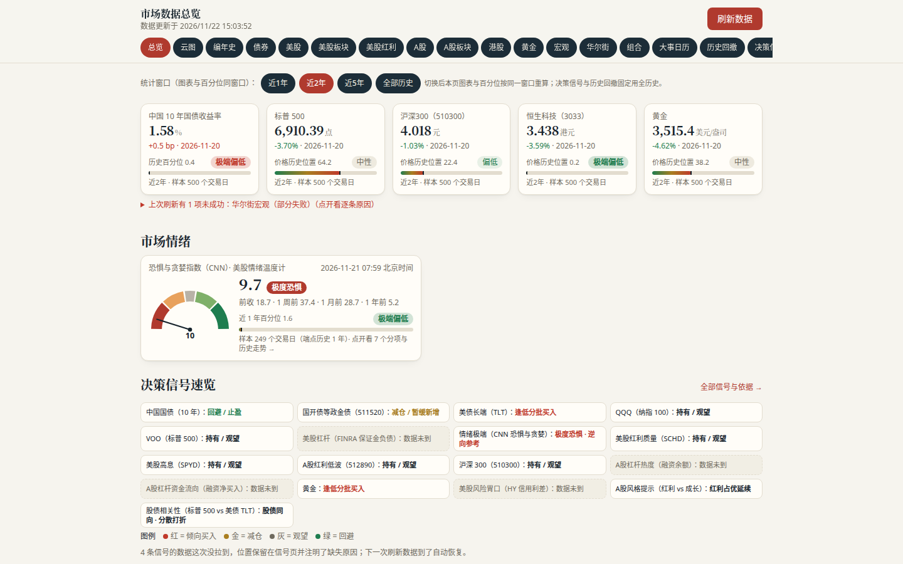
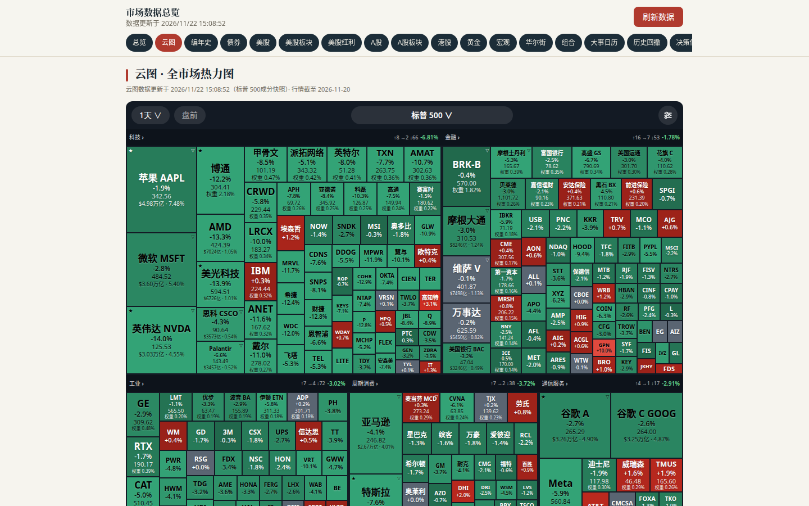
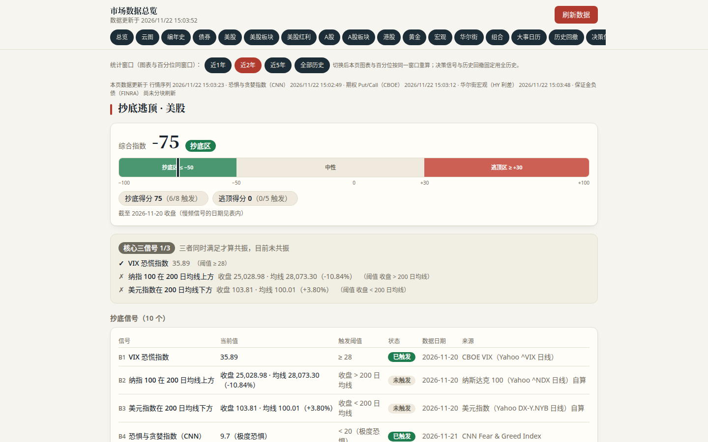
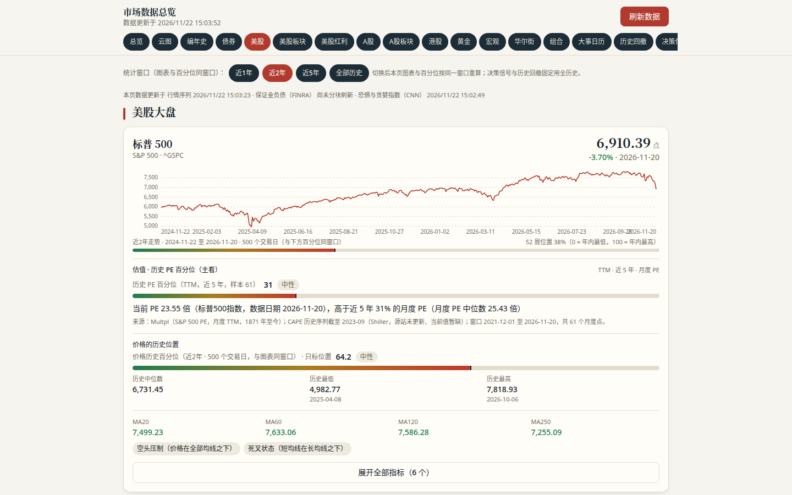
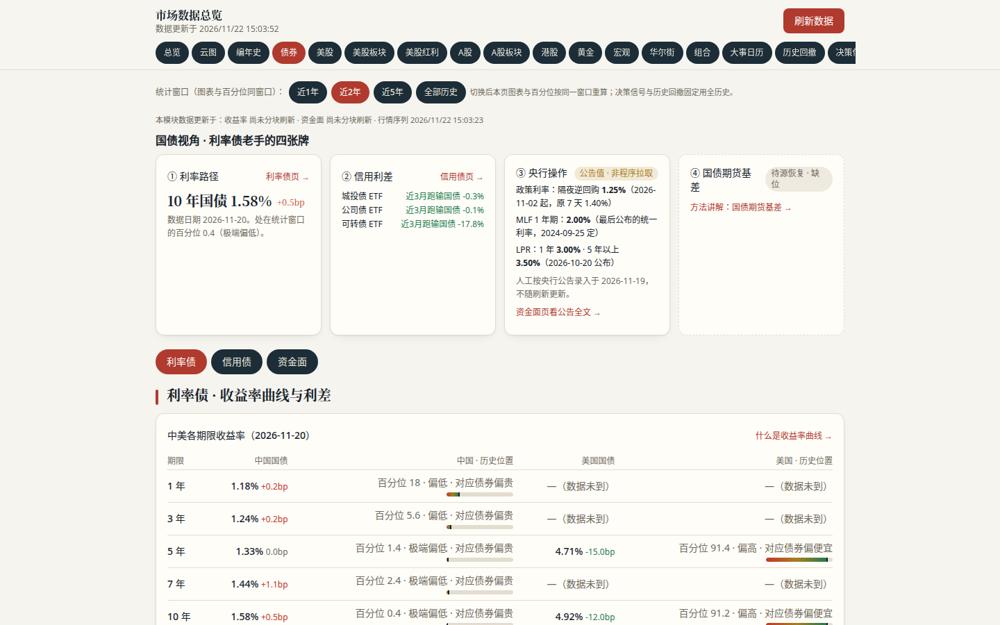
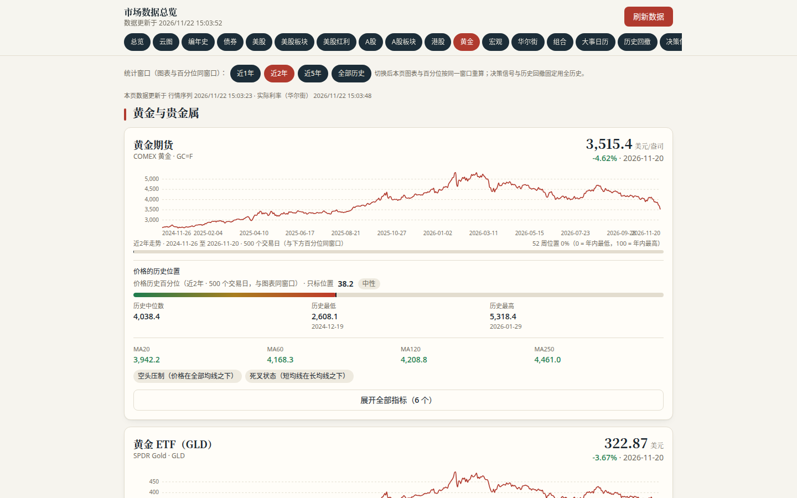

# 数据分析管控台

一个面向个人投资者的数据分析工作台：覆盖**中国国债、美股、A 股、恒生科技、黄金、宏观**六大类资产，每个关键指标都给**历史与现在**的对照（百分位 / 中位数 / 区间 / 历史回撤），再加规则化的决策信号参考与白话方法库。

> 本项目不构成任何投资建议。所有信号、百分位、回撤数字都只是统计描述与历史对照，最终决策由你自己负责。

## 功能

- **总览**：239 条序列的覆盖表，各市场核心指标一览
- **债券**：中债收益率曲线（1Y–30Y）、期限利差、政金债–国债利差、信用利差、资金面（FR007/DR007、MLF、LPR、同业存单）
- **美股 / 美股板块**：指数与 11 个 SPDR 板块（价格、百分位、回撤、PE）、红利风格、云图（标普 500 / 纳指 100 / 道指 / 沪深 300）
- **A 股 / A 股板块**：指数、10 个行业 ETF、两市融资余额
- **港股**：恒生指数、恒生科技 ETF
- **黄金**：金价、实际利率对照
- **宏观**：FRED/BEA 系列（实际利率、信用利差、期限溢价、企业利润、广义美元、核心 PCE）、CPI/失业率
- **抄底逃顶**：VIX + 均线 + 美元等 20 个信号的综合指数（回测校准过的分区阈值）
- **AI硬件现货**：DRAM/NAND 现货价、NVDA 显卡街价、HBM 参考价位、TrendForce 现货新闻（每日快照积累）
- **决策信号**：17 条规则化信号（带触发条件）
- **历史回撤 / 方法库 / 大事日历 / 美股编年史**（historyofmarket.com 数据，CC BY 4.0）

## 截图

下面是本机独立运行（`standalone/`）的实际界面，数据截至 2026-11-20 收盘：



*总览：各市场核心指标、CNN 恐惧与贪婪指数（9.7，极端恐惧）、决策信号速览。*



*云图：标普 500 成分股热力图，按行业分组，面积代表市值（红涨绿跌）。*



*抄底逃顶：VIX、均线、美元等 20 个信号的综合指数（回测校准过的分区阈值），当前综合指数 -75，落在抄底区。*



*美股：标普 500 两年走势、历史 PE 百分位、均线状态。*



*债券：中债收益率曲线（10 年国债 1.58%）、期限利差、资金面（FR007/DR007、MLF、LPR）。*



*黄金：COMEX 黄金期货两年走势与历史位置，及黄金 ETF（GLD）对照。*

## 架构：先入库，再展示

```
公开数据源 ──定时刷新/手动刷新──▶ SQLite（drizzle 迁移管理）
                                        │
页面只读库 ◀── 服务端动作读库、算指标 ───┘
```

- **数据先拉取存入数据库，页面只读库、不直连外部源**。刷新路径是纯程序：拉公开 JSON 接口 → 存库 → 用算术算指标，**不调用任何模型**，数据源结构不变就不花 token。
- 动态数据两种刷新方式：定时任务（`space.json` 里的 `managedCronJobs`，每小时一次）或页面右上角「刷新数据」手动刷新。刷新按分块做，失败隔离、可只重试失败的块；缺数据的卡片诚实显示原因，不会静默过期。
- 前瞻 PE 部分没有稳定的公开接口来源：标普 500 来自 FactSet Earnings Insight（每周 PDF）、纳指 100 来自 Siblis 月度页，手工抄录入库（见 `forward_pe` 表）。

## 快速开始

### 方式一：在 Muse 里作为 Space 运行（推荐）

本项目是一个 **Muse TypeScript Space**（fullstack artifact），最直接的用法是把它导入你自己的 Muse：

```bash
bun install          # 装依赖（类型检查用）
bun run typecheck    # 类型检查，应通过
bun run build:server # 服务端打包检查，应产出 server/dist/actions.js
```

> 注意：完整的客户端打包（`bun run build:client`）只能由 Muse 的 artifact 构建器完成，手工跑会被 SDK 拒绝——这是运行时的保护，不是代码问题。`bun run build` 在仓库外同样会在客户端那一步停下；正确流程是上面三步验证通过后，把源码导入 Muse 创建 Space，构建器会自动打包并发布。想在 Muse 之外跑，见下面的方式二 / 方式三（`standalone/` 的构建可以打包客户端）。

然后在 Muse 里创建 Space 并指向本仓库。运行时（`@hatch/space-sdk`）提供动作层、SQLite 数据库与定时任务；`drizzle/` 里的迁移会在首次启动时自动建表。启动后点一次「刷新数据」，种子数据会从各公开源拉取入库。

### 方式二：本机独立运行（macOS / Linux，不依赖 Muse）

`standalone/` 是不依赖 Muse 运行时的独立入口：同一个塔代码（`server/src/*`、`client/src/*` 原样不动），`@hatch/space-sdk` 由 `standalone/shims/` 里的最小兼容层替代，`POST /actions` 由 `standalone/src/server.ts` 直接分发。需要 Bun ≥ 1.2（服务端用 `bun:sqlite`）。

```bash
cd standalone
bun install   # 装依赖；postinstall 会在仓库根建一个 node_modules 软链（供 Tailwind 编译用，不进仓库）
bun run start # 先构建客户端 + 服务端包，再起服务；默认 http://localhost:3000
```

首次启动数据库是空的：服务会自动在后台跑一次全量回填（约 2 分钟，拉约 20 年历史），之后每小时自动刷新一次（`REFRESH_INTERVAL_MINUTES`，`0` 关闭）；页面右上角「刷新数据」仍可手动刷新。启动日志会写数据库路径、刷新间隔与回填进度。

环境变量（也可写进仓库根的 `.env`，见 `.env.example`）：

| 变量 | 默认 | 说明 |
|---|---|---|
| `PORT` | `3000` | 监听端口 |
| `HOST` | `0.0.0.0` | 监听地址 |
| `DATABASE_PATH` | `data/app.db` | SQLite 路径（相对仓库根；不存在自动建表） |
| `REFRESH_INTERVAL_MINUTES` | `60` | 定时刷新间隔分钟数，`0` 关闭 |
| `REFRESH_ON_START` | `auto` | `auto`：库空时启动后回填；`always`：每次启动都回填；`never`：不回填 |

数据持久化：数据库就是 `DATABASE_PATH` 那个文件，拷走即备份；删库重起会重新全量回填。

### 方式三：Docker 运行

```bash
cp .env.example .env   # 可选：填 FRED/BEA key；不填也能跑，只是相关卡片显示“密钥未配置”
docker compose up -d --build
# 打开 http://localhost:3000
```

`docker-compose.yml` 把 `./data` 挂到容器内 `/data`（`DATABASE_PATH=/data/app.db`），密钥走 `.env` 注入。镜像分两段构建：`oven/bun:1` 构建阶段装依赖、产出客户端与服务端包；运行阶段只留运行时需要的文件（服务端包、客户端静态文件、drizzle 迁移）。`.env` 与 `*.db` 不进镜像（见 `.dockerignore`）。

也可以只用 Dockerfile：`docker build -t data-analysis-console .`，再 `docker run -p 3000:3000 -v ./data:/data data-analysis-console`。

#### 与 Muse 版的差异

- **定时刷新**：Muse 版是 18 个托管 cron（07:00–24:00 每小时）；独立版是进程内定时器（默认每小时）+ 页面手动刷新，行为等价。
- **特权处理**：Muse 版把 FINRA xlsx 的下载解压放在特权宿主里；独立版在同一进程内直接跑（纯 `node:zlib` + fetch 代码，无额外依赖）。
- **无跨端广播**：Muse 版动作写库后会推所有打开的页面刷新；独立版没有这个推送，各浏览器标签按自己的 staleTime（30 秒）重新拉取。
- **无 agent / 推理 / 工具调用**：塔本身不用这些（动作只用 `ctx.db`、`ctx.executePrivileged`、`ctx.invalidateQueries`），独立版里调用它们会直接报错。
- **健康检查**：独立版多一个 `GET /healthz`（`{ok, series, uptimeSec}`）。

## 配置 Token

只有两个数据源需要 key，其他全部免 key：

| Key | 用途 | 注册（免费） |
|---|---|---|
| `FRED_API_KEY` | 华尔街模块：实际利率、信用利差、期限溢价、政策利率、金融条件、消费者信心、企业利润、广义美元、核心 PCE 等 | https://fred.stlouisfed.org/docs/api/api_key.html |
| `BEA_API_KEY` | 企业利润（BEA 直连 NIPA T11200） | https://apps.bea.gov/api/signup/ |

两种配置方式（数据库优先、环境变量兜底）：

```bash
cp .env.example .env   # 填入上面两个 key
```

或在管控台里调用内置动作 `setFredApiKey` / `setBeaApiKey` 写入数据库（密钥只存库里，不进源码、不进日志、不进任何接口返回值）。

**缺 key 也能跑**：没配 FRED/BEA 时，依赖它们的卡片会诚实显示“密钥未配置”，其余模块不受影响。

## 换成你自己的自选股与持仓

- **自选股**：只改 `server/src/watchlist.ts`（示例是 9 只美股）。改完重新构建即可，刷新流程与卡片口径和指数行完全一致。
- **个人持仓**：`config/holdings.example.json` 是模板（示例数字，与任何人无关）。复制成 `config/holdings.json` 按格式填你自己的（代码、股数、成本、账户）。**当前版本管控台不直接读取这个文件**——它是不含个人数据的看板；这个文件是给你自己扩展持仓视图（股数×现价、盈亏）时用的格式约定。不要把真实的股数、成本、账号提交到公开仓库（`.gitignore` 已屏蔽 `config/holdings.json` 与 `*.db`）。

## 数据来源

| 数据 | 来源 | Key |
|---|---|---|
| 美股/A 股/港股/黄金/原油/VIX/汇率价格 | Yahoo Finance chart API | 无 |
| 中美国债收益率 | Eastmoney datacenter（RPTA_WEB_TREASURYYIELD） | 无 |
| 中债收益率曲线、政金债利差 | ChinaBond（中债）官网接口 | 无 |
| 资金面 FR007/DR007、MLF、LPR | ChinaMoney | 无 |
| 恐惧与贪婪指数 | CNN（仅 1 年历史，百分位按 1 年口径标注） | 无 |
| 保证金负债 | FINRA 月度 xlsx | 无 |
| Put/Call | CBOE 官方统计文件 | 无 |
| 标普 500 TTM/CAPE、A 股 PE | Multpl、中证指数官网 JSON | 无 |
| 恒生/纳指 PE 年度点 | Siblis Research | 无 |
| FRED 系列、BEA 企业利润 | FRED / BEA 官方 API | **要 key** |
| 美股编年史 | historyofmarket.com（CC BY 4.0，页面有署名） | 无 |

## 已知限制

- CNN 恐惧与贪婪只有 1 年历史；AAII 情绪、成分股宽度没有公开可拉的 API，目前显示“暂无数据”。
- 前瞻 PE（指数与板块）目前是每周手工抄录，不是全自动。
- 部分境外接口在部分地区网络下可能被拦截，刷新失败会在刷新日志里写明原因并可重试。
- 独立运行（`standalone/`）需要 Bun ≥ 1.2；Docker 镜像在本仓库 CI 外没有实际构建验证，见 `Dockerfile` 注释。

## 许可证

MIT（见 `LICENSE`）。数据来源各自的许可与署名要求见上表与页面标注。
